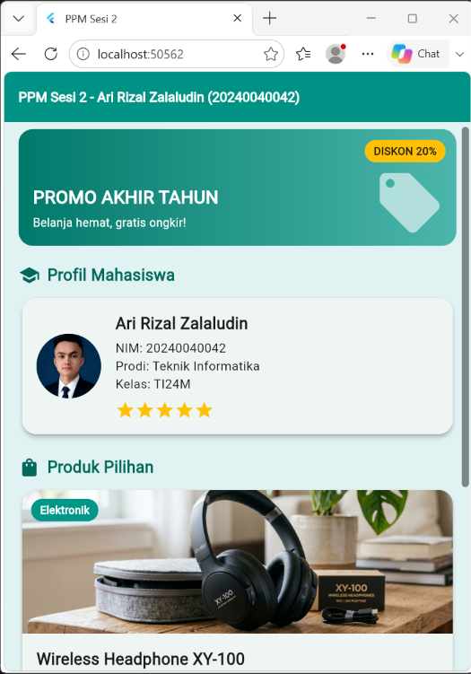
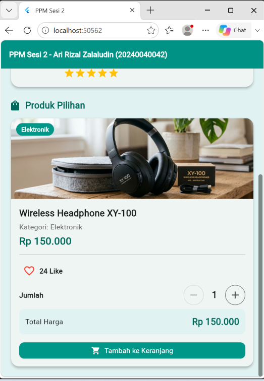
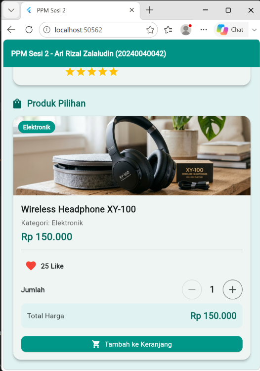
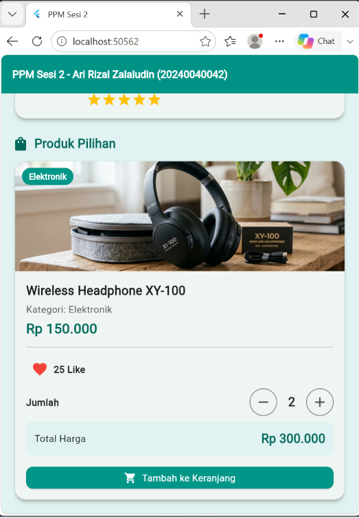
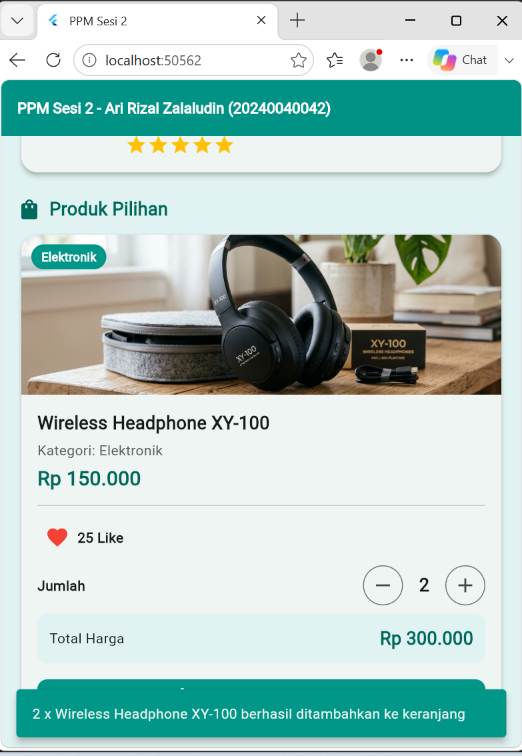

# PPM Sesi 2 - Dasar Flutter dan Widget

Aplikasi Flutter sederhana berisi halaman **Product & Profile** untuk tugas mata kuliah Pemrograman Perangkat Mobile.

## Identitas

| Keterangan    | Data                |
|---------------|---------------------|
| Nama          | Ari Rizal Zalaludin |
| NIM           | 20240040042         |
| Program Studi | Teknik Informatika  |
| Kelas         | TI24M               |

## Fitur Aplikasi

1. **AppBar** berisi `PPM Sesi 2 - Ari Rizal Zalaludin (20240040042)`.
2. **Tema warna** Teal.
3. **Banner Promo** menggunakan `Stack` dan `Positioned`.
4. **Kartu Profil Mahasiswa** (`StatelessWidget`): foto profil, nama, NIM, prodi/kelas, dan 5 ikon bintang.
5. **Kartu Produk** (`StatefulWidget`):
   - Gambar produk, nama produk, harga, dan kategori.
   - Tombol **Favorite**: ikon hati berubah dan jumlah Like bertambah/berkurang.
   - Tombol **-** dan **+** untuk jumlah produk (minimal 1).
   - Total harga berubah sesuai jumlah produk.
   - Tombol **Tambah ke Keranjang** menampilkan `SnackBar`.

## Widget yang Digunakan

`Scaffold`, `AppBar`, `Row`, `Column`, `Container`, `Card`, `Stack`, `Positioned`, `Icon`, `ElevatedButton`, `IconButton`, `SnackBar`, `StatelessWidget`, `StatefulWidget`.

## Cara Menjalankan

```bash
flutter pub get
flutter run -d chrome
```

## Screenshot Hasil Aplikasi

### 1. Tampilan awal


### 2. Kartu produk (kondisi awal: 24 Like, jumlah 1)


### 3. Tombol Favorite ditekan (hati berubah, Like menjadi 25)


### 4. Jumlah produk ditambah (jumlah 2, total Rp 300.000)


### 5. Tambah ke Keranjang (SnackBar muncul)


## Struktur Project

```
Jawaban_PPM/
├── assets/
│   └── images/
│       ├── profil.jpg
│       └── produk.jpg
├── lib/
│   └── main.dart
├── screenshots/
├── pubspec.yaml
└── README.md
```
